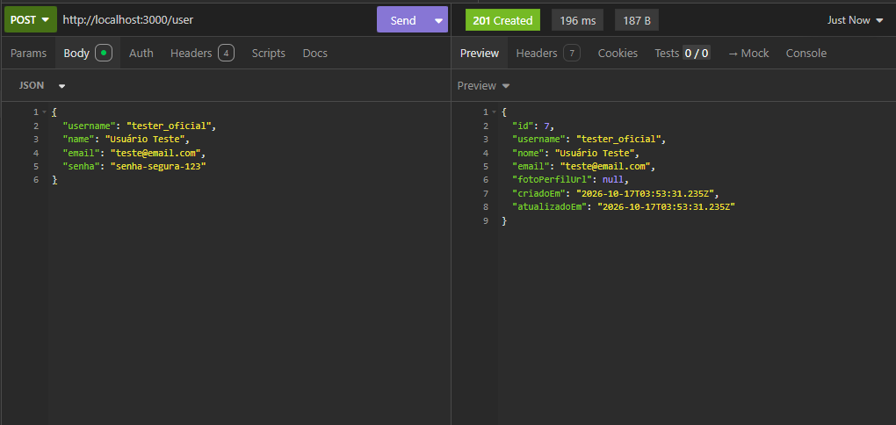
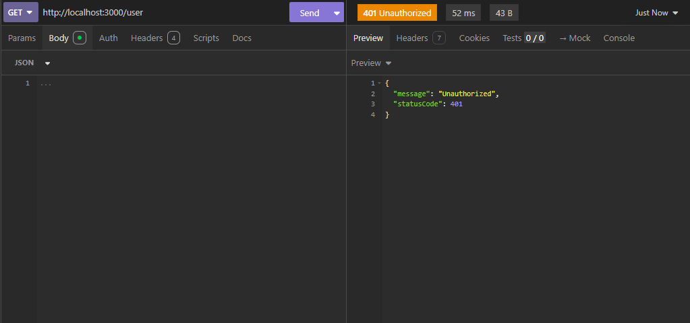
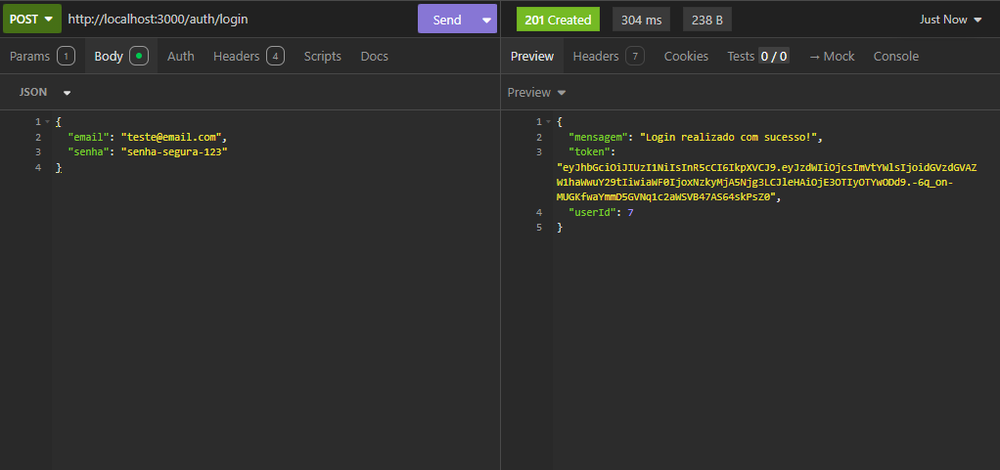
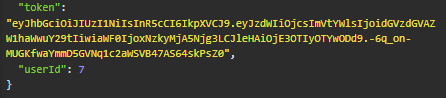
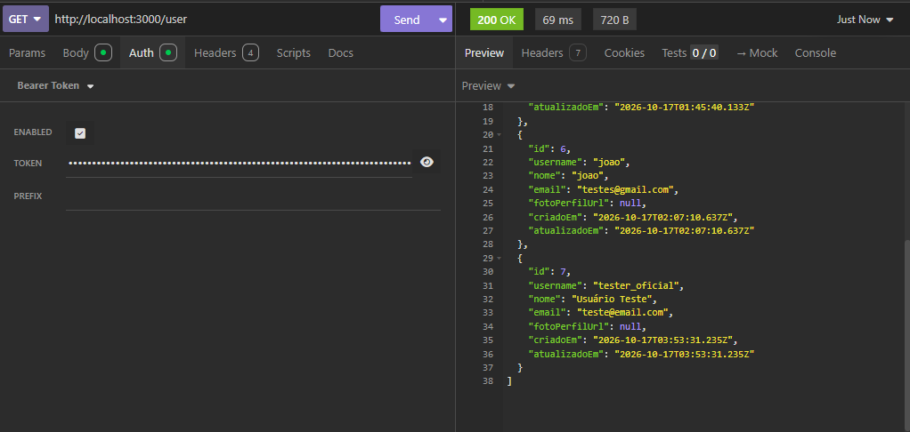
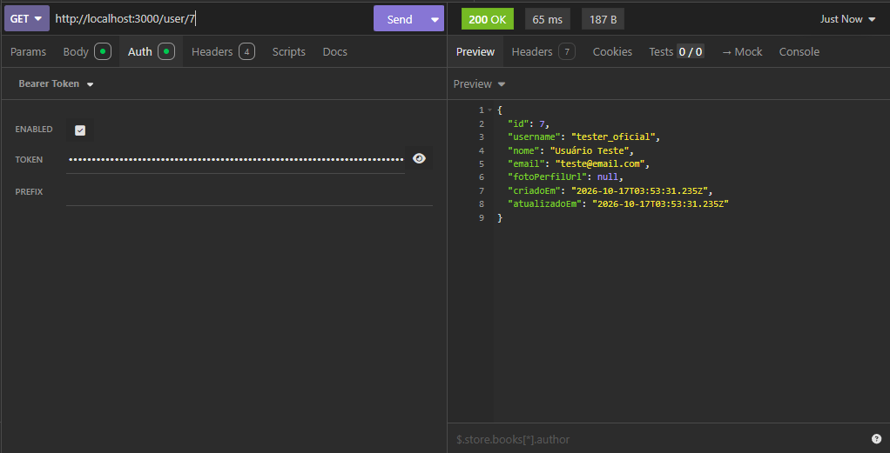

# Evidências de Teste - CRUD de Utilizador e Autenticação JWT

Este documento contém as evidências de validação das rotas da API desenvolvidas para o módulo de utilizadores, testadas através do Insomnia.

---

## 1. Criar um Utilizador (POST /user)
**Objetivo:** Verificar a criação de um novo utilizador na base de dados, garantindo que o `senhaHash` **não** é retornado na resposta por motivos de segurança.
**Resultado:** Status `201 Created`. Utilizador inserido com sucesso na base PostgreSQL.

---

## 2. Tentativa de Acesso sem Permissão (GET /user)
**Objetivo:** Validar o funcionamento do `AuthGuard` ao tentar aceder a uma rota protegida sem enviar o *Token JWT*.
**Resultado:** Status `401 Unauthorized`. A API bloqueou o acesso corretamente.

---

## 3. Autenticação e Geração de Token (POST /auth/login)
**Objetivo:** Testar o *login* com credenciais válidas e verificar a emissão do *Token JWT*.
**Resultado:** Status `200/201 OK`. Token gerado com sucesso após o `bcrypt` validar a senha criptografada.

 Usando o token 
---

## 4. Listar Utilizadores com Permissão (GET /user)
**Objetivo:** Aceder à rota protegida enviando o *Token JWT* através do cabeçalho de autorização (Bearer Token).
**Resultado:** Status `200 OK`. Lista de utilizadores devolvida (novamente, sem expor os hashes de senha).

---

## 5. Buscar Utilizador Específico (GET /user/:id)
**Objetivo:** Validar a busca por ID numa rota protegida.
**Resultado:** Status `200 OK`. Dados do utilizador retornados corretamente.

