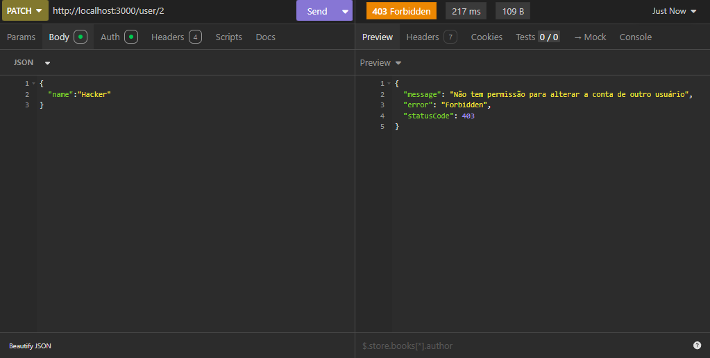
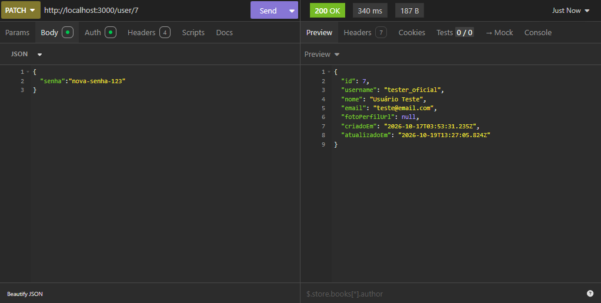
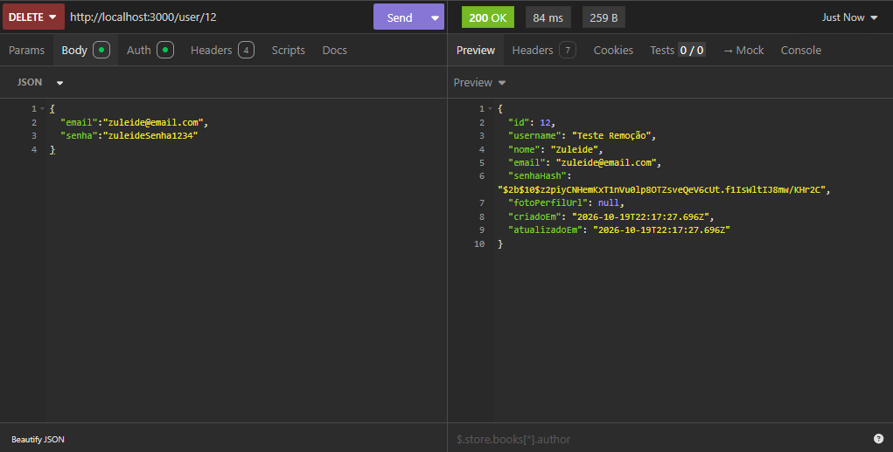

# Evidências de Teste - CRUD de Utilizador e Autenticação JWT

Este documento contém as evidências de validação das rotas da API desenvolvidas para o módulo de utilizadores, testadas através do Insomnia.

---

`Dica Extra: O comando npx prisma studio pode ser utilizado para verificar o banco de dados em tempo real de forma visual`

`Comandos úteis:` 

```bash
npx prisma migrate reset
# e
npx prisma db push --force-reset

```


## 1. Criar um Utilizador (POST /user)
**Objetivo:** Verificar a criação de um novo utilizador na base de dados, garantindo que o `senhaHash` **não** é retornado na resposta por motivos de segurança.
**Resultado:** Status `201 Created`. Utilizador inserido com sucesso na base PostgreSQL.


---

## 2. Tentativa de Acesso sem Permissão (GET /user)
**Objetivo:** Validar o funcionamento do `AuthGuard` ao tentar aceder a uma rota protegida sem enviar o *Token JWT*.
**Resultado:** Status `401 Unauthorized`. A API bloqueou o acesso corretamente.


---

## 3. Autenticação e Geração de Token (POST /auth/login)
**Objetivo:** Testar o *login* com credenciais válidas e verificar a emissão do *Token JWT*.
**Resultado:** Status `200/201 OK`. Token gerado com sucesso após o `bcrypt` validar a senha criptografada.
 
Usando o token abaixo:


---

## 4. Listar Utilizadores com Permissão (GET /user)
**Objetivo:** Aceder à rota protegida enviando o *Token JWT* através do cabeçalho de autorização (Bearer Token).
**Resultado:** Status `200 OK`. Lista de utilizadores devolvida (novamente, sem expor os hashes de senha).


---

## 5. Buscar Utilizador Específico (GET /user/:id)
**Objetivo:** Validar a busca por ID numa rota protegida.
**Resultado:** Status `200 OK`. Dados do utilizador retornados corretamente.


## 6. Tentar Alterar Outro Utilizador (Autorização Negada)
**Objetivo:** Validar a regra de negócio que impede um utilizador logado de modificar (PATCH) a conta de outro utilizador.
**Resultado:** Status `403 Forbidden` (ou `401 Unauthorized`). A API bloqueou a ação de alteração indevida com sucesso.



---

## 7. Atualizar a Própria Conta e Senha (PATCH Autorizado)
**Objetivo:** Modificar os próprios dados (ex: alterando a senha) enviando o Token JWT correto, e verificar a resposta.
**Resultado:** Status `200 OK`. Os dados foram atualizados corretamente no banco de dados e o retorno omite o novo `senhaHash`.




---

## 8. Apagar a Própria Conta (DELETE)
**Objetivo:** Eliminar a própria conta de utilizador de forma segura validando o Token JWT.
**Resultado:** Status `200 OK` (ou `204 No Content`). O registo do utilizador foi removido com sucesso da base de dados.


